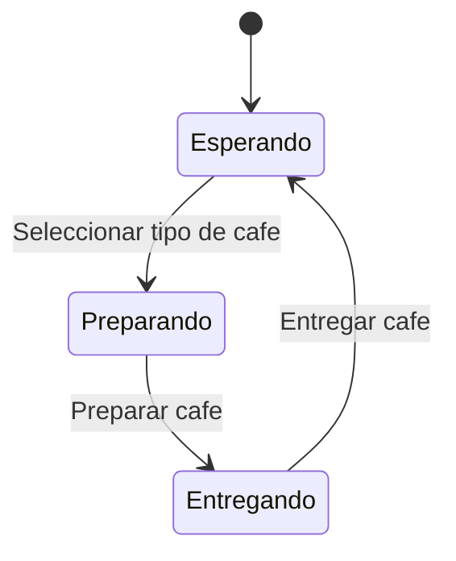

# Maquina de estados

Maquina de cafe, para tres tipos de cafe

## Estados:

- Esperando: La maquina esta esperando a que el usuario seleccione un tipo de cafe.
- Preparando: La maquina esta preparando el cafe seleccionado por el usuario.
- Entregando: La maquina esta entregando el cafe preparado al usuario.

## Transiciones:

- Seleccionar tipo de cafe: Transicion de Esperando a Preparando.
- Preparar cafe: Transicion de Preparando a Entregando.
- Entregar cafe: Transicion de Entregando a Esperando.

## Variables de las transiciones en Kotlin:

Los estados se representan con una `sealed class` y cada transición con una
instancia de `Transicion`, que guarda el estado de origen y el estado de destino:

```kotlin
sealed class Estado {
    data object Esperando : Estado()
    data object Preparando : Estado()
    data object Entregando : Estado()
}

data class Transicion(
    val origen: Estado,
    val destino: Estado
)

val seleccionarTipoCafe: Transicion =
    Transicion(Estado.Esperando, Estado.Preparando)
val prepararCafe: Transicion =
    Transicion(Estado.Preparando, Estado.Entregando)
val entregarCafe: Transicion =
    Transicion(Estado.Entregando, Estado.Esperando)
```

## Diagrama de estados:


