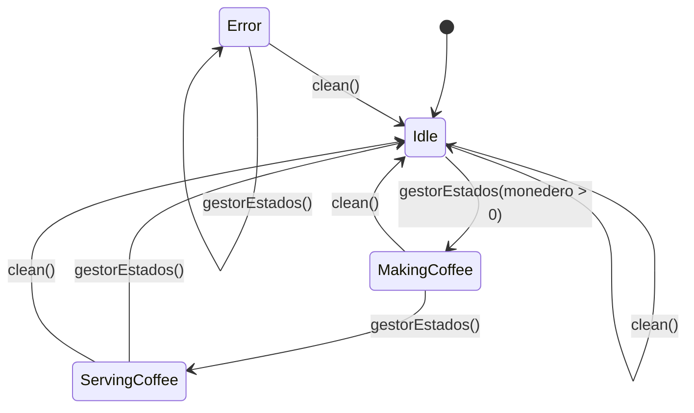

# Máquina de estados

La máquina de café representa sus estados con `CoffeeMachineState`. Cada
llamada a `gestorEstados(monedero)` realiza como máximo una transición:

- `Idle(timestamp)`: espera una moneda; `timestamp` se inicializa al entrar en
  este estado.
- `MakingCoffee`: está preparando el café.
- `ServingCoffee(type)`: hay café servido; `type` indica el tipo de café.
- `Error(message)`: la máquina está en error; `message` contiene el motivo.

`gestorEstados` solo inicia la preparación cuando `monedero > 0`. En el código
actual, el café servido es `"Nescafé"` y no hay ninguna transición que asigne
el estado `Error`; este estado permanece hasta que se limpia la máquina.
`clean()` lleva la máquina a `Idle` desde cualquiera de los estados.

## Diagrama de estados

