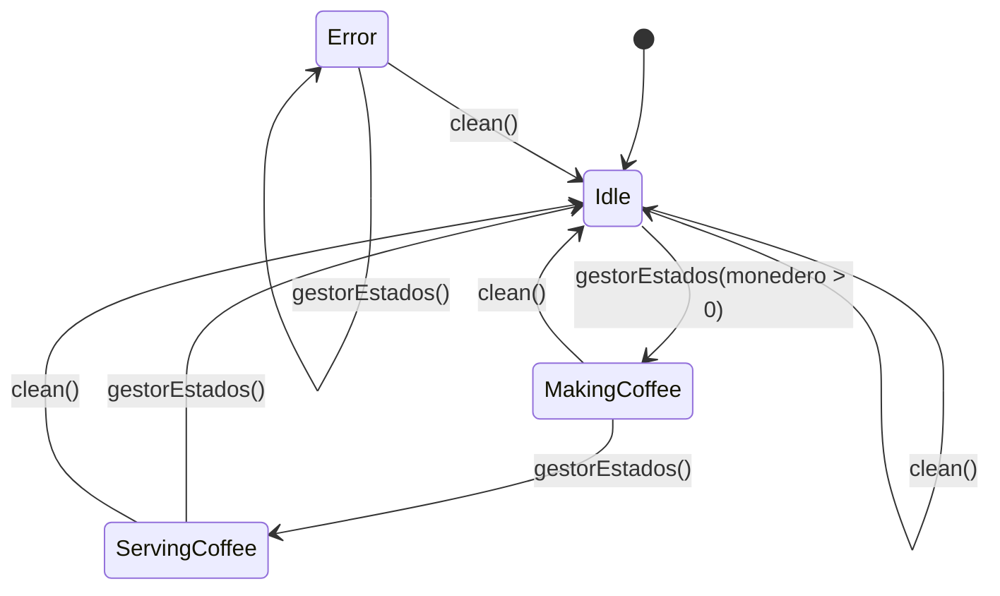

# Máquina de Estados... de Café

## Funciones en los estados

En esta rama vamos añadir una funcionalidad a los estados.+

### Función `onEnter()`

Cuando la máquina llega a un estado ejecuta esta función, todos los estados tienen esta función
## Diagrama Máquina

