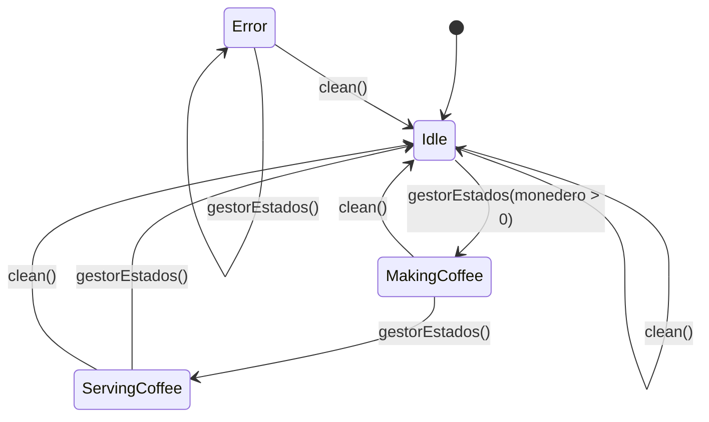

# Máquina de Estados... de Café

## Tests

En esta rama vamos añadir los tests unitarios.

Tendremos que revisar el código para que las funciones tengan valores devueltos, y así poder testearlas.

## Diagrama Máquina

